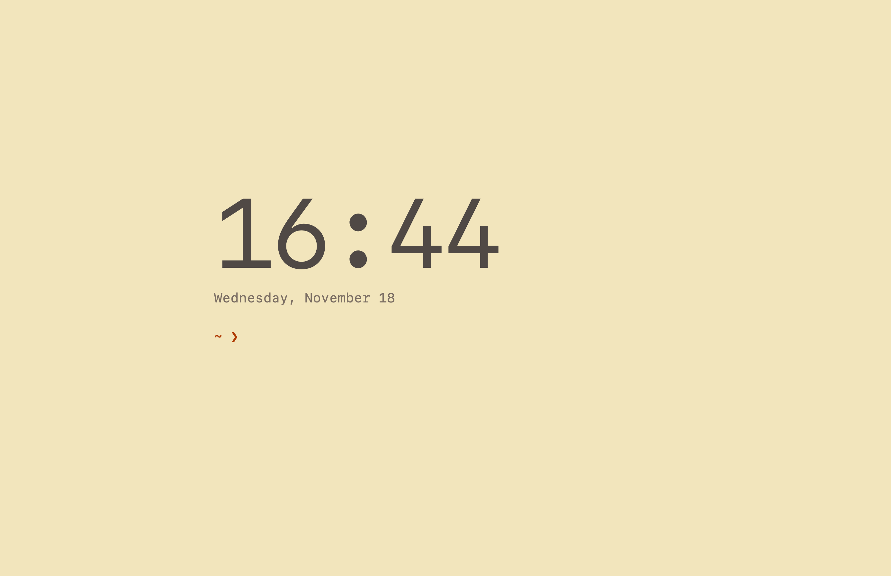

# custom-homepage-ff

Firefox doesn't let extensions like Vimium run on its built-in new tab page, so I made my own new tab page at [home.selimd.me](https://home.selimd.me) where my keyboard shortcuts work.

As you type, it recommends matching shortcut keys like `gh` for GitHub, theme commands, and search suggestions from Google through a small Cloudflare Worker.
